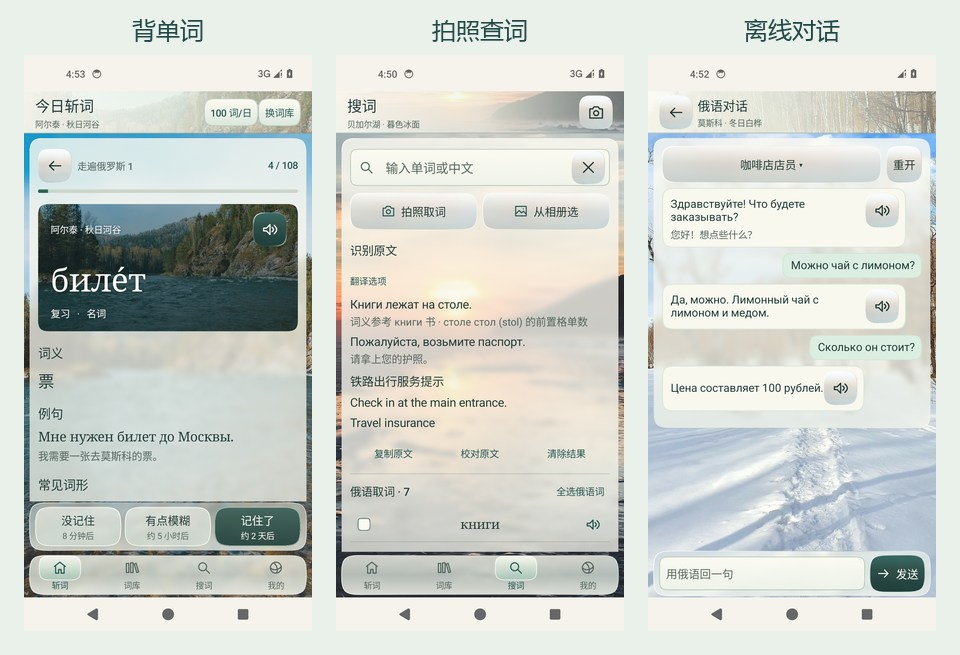

# 词汐 · 安卓俄语学习

用俄语词卡背词、拍照查词，再用手机上的离线模型练对话。

**[国内加速下载 ARM64](https://gh-proxy.org/https://github.com/ChenLaoshiYF/Slovo/releases/latest/download/Slovo-ARM64.apk)** · **[下载安卓安装包](https://github.com/ChenLaoshiYF/Slovo/releases/latest)** · [提交使用反馈](https://github.com/ChenLaoshiYF/Slovo/issues/new)

- **背词**　21 个学习词库，内置 7,219 个词的录音，另带整句离线语音引擎。根据你的作答调整复习间隔。
- **拍照查词**　识别中、英、俄文字。长按俄语看释义或听读音，选中的词可以加入词库。
- **练对话**　在「我的 → 俄语对话」试着用俄语点单、买票或聊天。打开手机 AI 后可以离线使用。

## 安装

下载入口使用固定文件名 `Slovo-ARM64.apk` / `Slovo-ARM32.apk`，后续版本沿用。旧版应使用对应版本页中的链接；把带旧版本号的文件名放在 `latest/download` 后会返回 404。若社交应用内无法发起 APK 下载，请复制到系统浏览器打开。

支持 Android 8.0 及以上。多数手机选 **ARM64**，使用 32 位安卓系统的设备选 **ARM32**。安装包约 510 MB，包含离线模型。第一次使用手机 AI 会在设备上准备模型文件。

## 学习与统计

启动即进入「今日斩词」。选择「看选项」做题，「看释义」翻开词卡，或直接点「我认识」按已记住计入复习模型并进入下一词。「我认识」有短时防误触保护。首页点每日词量可填写 0–9,999 或选 5、10、20、50、100。填 0 只做复习。每轮最多放入 100 个新词，完成一轮可接着练。在词卡内容区向右滑或点「上一词」可查看当天的作答，向左滑或按「返回当前词」继续。不同词库共享同一词的学习记录。

21 个学习词库，每册 355–3,240 词，共 19,510 个词库条目，按词去重 7,219 个。含走遍俄罗斯四册、东方大学俄语八册、新一代大学俄语两册及新起点、高考、四级和六级等。每册支持查词、看主题词、练未学词和听发音。词表按学习阶段和主题独立编排，主题词可单独查看。书目和封面用于识别学习方向，词表没有逐课转录。7,219 个学习词的俄语音频随包提供。

「我的 → 记忆曲线」有三个视图。

- 遗忘曲线。看 7、14 或 30 天的个人预测、新词默认基准，并模拟今天先复习一批词。点或拖动图表选择日期。
- 学习情况。按日、周、月查看实际练习次数，可在回忆结果、新词与复习之间切换。缺少逐次评分的旧记录以灰色显示。
- 记忆持久度。根据每个词最近一次作答的模型半衰期，查看不同门槛的历史词数和当前分组。点当前分组可进入对应词表。

复习计划、风险词表、评分明细、预测校准和专项练习保存在本地。专项练习支持听写、重音、变格、动词体、介词、例句和时间等题型。俄语明信片与个人粒子像可从「我的」进入。

## 搜词和照片

支持俄语词形、原形与中文检索。可通过相机或相册选图。设备上识别照片中的俄文、中文和英文，逐句显示原文，俄语句子下方放中文译文。长按原文选中文字可查词、听读音或复制。俄语词排在英文短语和单词前面。俄语词默认不选，选中后可入库或取消，词行左右按钮各占 48 dp。俄语优先播放随包录音，其余词形与整句使用内置 Denis 语音。读到「занимает」会朗读这个词形本身，不会替换成原形。中英文原文另带轻量离线合成声音，无需安装任何系统语音包或联网。

单词、常见词形和句库里的句子直接离线翻译，无需开启 AI。陌生整句会先显示词义参考，可选手机 AI 生成整句。照片中的俄语也可明确选择 MyMemory 联网翻译，每次最多三句并行，有短超时和会话缓存。图片留在本机，原文和词行可以先使用。来源和许可见 notices。

## 平板与详细词典

同一安装包适配 Android 手机、平板和可调整大小的窗口。600 dp 起采用居中阅读布局，840 dp 起词条页面把释义与变化表、例句分栏，对话页显示独立练习提示。支持横竖屏切换，输入草稿和学习状态保留。所有页面顶栏保持相同高度。

详细词典保留 86,791 条完整词条，27,249 条包含 OpenRussian 变化表。可查看屈折词形对应的原形、重音、IPA、体的对应词、完整义项、双语例句及已有的近反义词。部分常用词有原创接格、搭配和易混用法说明。数据覆盖程度不同，未收录的内容不会补成虚构资料。每行词形与例句均可离线朗读，支持跳转在线维基词典、OpenRussian 和俄语老师。

## 应用更新

在「设置 → 检查更新」查看版本。默认通过免费的公共 GH-Proxy 访问 GitHub，失败会尝试原站，也可手动选原站。应用会匹配 CPU 架构，显示下载进度，并核对 SHA-256、包名、版本及本机安装签名，再交给安卓安装器。公共加速服务没有可用性保证，发布页保留原站入口。版本源是仓库 updates/stable.json。

## 外观

顶栏是 60 dp 通栏风景图，下沿有一条细分隔线。51 张俄罗斯风景均为 1080 × 2160 等比裁图。阅读区和底部玻璃取样自对齐的全分辨率高斯模糊纹理。卡片、按钮和底栏的轮廓使用三阶贝塞尔曲线。切页和进入下一张学习卡片时，照片默认交叠淡变 320 毫秒。设置中的「风景柔光」可延长淡变并加入柔光。关闭系统动画或启用省电模式后直接换景。自动换景避开最近 30 张，设置可固定一处。设置署名为小陈同学、小余同学，安卓图标为深蓝绿底的花体「ф」。

## 学习助手和 AI

打开「我的」即可看到当天的学习提醒。默认按待复习词数、当天新词目标和近期作答即时整理。点提醒可打开学习助手，按可用时间安排一轮。提醒来源在「设置 → 学习提醒」中选择，支持默认建议、词汐内置模型和自己的 API 模型。选模型后进入「我的」或学习助手时，每种模型来源每天最多自动尝试一次，当天可复用结果。等待生成或模型暂时不可用时，直接显示进度建议。

安装包带有 Qwen3-0.6B 量化模型，可离线写提醒或试译俄语短句。在「AI 与翻译」关闭手机 AI 后，也可继续使用本机查词。首次使用需要约 397 MB 额外空间准备模型文件。实际响应时间取决于手机。

「我的 → 俄语对话」提供咖啡店店员、车站售票员、俄罗斯同学和俄语老师四个角色。开启手机 AI 后即可离线发送消息，多轮对话带入最近三轮上下文。切换角色可回到该角色在本次运行中的记录，点「重开」可清空一段对话。俄语回复支持选词查询，整句试听使用内置离线语音。常用场景有校订课卡，自由对话使用小模型生成。小模型仍可能出现语法或理解错误，可以切换自己的 API。

自带 API 支持 DeepSeek、千问北京和 OpenAI 预设，选平台后填 API Key。自定义 OpenAI 兼容服务支持 HTTPS 地址、模型名称和密钥。Android Keystore 加密保存密钥。DeepSeek 提供应用内余额查询，其他预设可打开服务商用量控制台。应用在服务商返回 token 数时显示上次使用量。选择自带 API 生成建议会发送统计和计划，选择自带 API 翻译会发送主动提交的句子。

## 构建

Android 原生 Java、SQLite 和 Canvas。Tesseract 单线程模型只在识图时加载。数据编排工具在桌面运行。课堂听读是独立扩展，支持导入 .tingye 文件。

构建需 Android SDK 34、Gradle Wrapper 8.6、AGP 8.4.2 和 JDK 21。先运行 `python tools/fetch_speech.py` 准备语音依赖和固定版本 eSpeak 源码，用 `tools/build_speech.ps1` 为三个 ABI 编译辅助语音 JNI，再运行 `python tools/fetch_model.py` 下载并校验固定版本的 Qwen 模型，拥有 GGUF 文件也可将其路径作为参数传入。已发布的 APK 内含模型。

设好 ANDROID_HOME 与 JAVA_HOME 后，在本目录执行 `gradlew.bat assembleRelease lintRelease`。依赖已缓存的环境可加 `--offline`。APK 输出在 app/build/outputs/apk/release。发布签名文件由维护者在仓库外保管。

手机模型的 JNI 位于 app/src/main/cpp，预编译库位于 app/src/main/jniLibs。可用 Android NDK r27c、CMake、Ninja 和 llama.cpp b7371 重编译。固定量化模型链接与校验值见 notices/端侧模型和服务.txt，使用 tools/pack_model.py 分片。

## 许可

组合应用按 GPL-3.0 提供，原因是内置 Piper 语音前端包含 eSpeak NG。对应应用及集成源码在本仓库，固定版本依赖源码和许可在 notices 中列明。词典、模型、摄影等独立素材保持各自许可。应用内「设置 → 开源许可」可以查看。

## 素材来源

公开发行版使用词汐自制词库封面。风景、词典和模型的来源及许可见 notices。

## 一起用的俄语工具

上俄语网课时，可以用 [纸音](https://github.com/ChenLaoshiYF/zhiyin) 在 Windows 上显示俄汉字幕。
